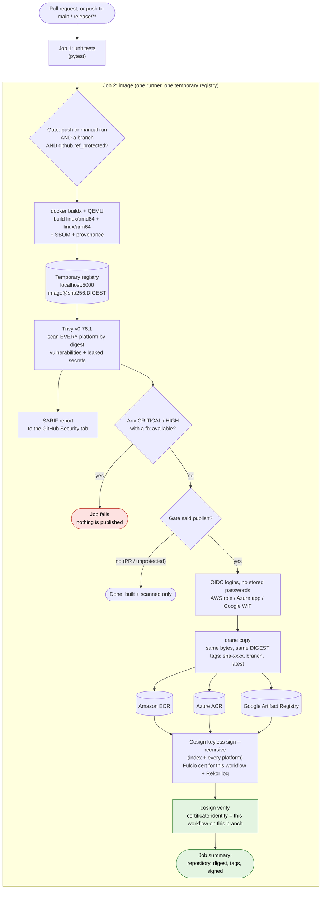

# Problem #6

**Create a GitHub Actions workflow (or GitLab CI) that builds a multi-arch Docker image, scans it with
Trivy, signs it with Cosign, and pushes to ECR/ACR/GCR only on protected branches.**

This project uses **GitHub Actions**. "GCR" means **Google Artifact Registry**: Google shut down
Container Registry (gcr.io) on 18 March 2025, and Artifact Registry is its replacement.

## What it does

| Step | Tool | Every run | Protected branch only |
|---|---|---|---|
| Unit tests | pytest | ✅ | |
| Build `linux/amd64` + `linux/arm64`, with SBOM and provenance | Docker Buildx + QEMU | ✅ | |
| Scan **every** platform for vulnerabilities and leaked secrets | Trivy v0.76.1 | ✅ | |
| Results in the GitHub **Security** tab | SARIF upload | ✅ | |
| Copy the exact scanned image to ECR / ACR / Artifact Registry | crane | | ✅ |
| Sign the image and every platform inside it, keyless | Cosign v3.1.4 | | ✅ |
| Verify the signature | Cosign | | ✅ |

The key ideas:
- **Build once, publish the same bytes.** The image is built once into a temporary registry inside the
  job. Trivy scans that exact digest, and `crane copy` moves those same bytes to each cloud registry.
  The published digest is the scanned digest, and the scripts check it.
- **Two locks on publishing.** First, the workflow's gate publishes only for a push (or manual run) on a
  branch where `github.ref_protected` is true. Second, the cloud roles trust only the protected
  branch, so even an edited workflow on another branch cannot log in.
- **No stored secrets.** AWS, Azure, Google and Cosign all use GitHub's short-lived OIDC token.

## Architecture



The diagram was made with Mermaid. Its source is in `docs/pipeline.mmd`, and GitHub also draws it from
the block below. [Open it in the Mermaid editor](https://mermaid.ai/app/plugin/save?state=pako%3AeNp1VGFz2zYM_Ss45YvTyonjpOlNt2Vz7MRxb10621tvV-92lATJPFOkRlJO1F7_-0BSTu008xeLIPHwADzgS5SpHKMkKoR6yNZMW1hOVhLoZzUvS9S9T6voQyMEaPy3QWNjUBrqxqzBKqgYl3BKVwKZwdNXr1bR38fQ71-Bpafk-U6lcJZAI7n1JvNjqk-venXrDsf0uotFJ-9WMotfVtGU_pIQhaJVTDaMCDTSe49-mwCDVDOZrZ8MJbfrJj3RWPxTa2Uxs5j_vIq-rmSIYJq01Kxew7v762FHbJgAr1iJAD0l0eFL1JQffVusaqWZbim3khur229k3S_nmkJwJWF5_c3q2Ps00oaLnKLkKtugDsdHeA2_37z_w1P2FhBcNo-nrMovL-iyO-nq8sK_eQ2L6_v3dEEJbVFSunjAIWC4cEJlTHzqraLld7Q9kr9fK2OTN4PBwJt84r-YNRu-uUwms-nNYrmKjvfQvY9HNxmTlMtS820L28HJ28uTM4_hLuDmz5v5X1ALZgulK0hbqk1J7fQvto2gkrKUC245Gpcksg3mYDDTaM1BPh7OB2SaFxRxMZrPbikTSinAkeLsGmHK7V2TwgKzRnPbgmXpy0A1M4bUNJItjOez5Ww8-pXUejeb3nm4B9IMKangj8C2jAuWCgya2SE5AEKCFk1gZlV91uvkU5BL0LNUds1lCdyQZlPBzRpzNwnfA0kViDVpp3JKluc7r2fBKUdyWUXk1PswJ-aNfNI2yfGJ0dAxmpBsE68JS2V2JZBUZyVF-4xJQN1lJFTJXXfvZ5NxOJjYsSRcTf6O94PSechz9HEBWgkkKqPPjUZgdU3fU6VKMn6c3R60waP5IJmqW4qR0ciiPwT5sApJLzT7MfjvIMPQaVaaBEie_Uf6xd20x0AyI20dhHF4PgpJys3AqGKfaS5vxvNDQT-9Y907n8Hof5-VzD_rkhtpywuWWZh3g3XoRbFDO3jpqjlW7gM22AqkxvtDv6-dYA3fYliCXObolgJukQZ2N0HH_vK2ERlXkCEtZLKS7Elb1IiN29PkM8cNWanCB6Vgeyz2t9JL1o7TFVB0Xvj2BNLh7Fm48LzgGRW9z3OU1k3bT8_IUK29IbTogE-ACsGbqqK9tJud7pj4MG7CDSfBtXG3PGJwAog9yf1RQpnvFnomSJoTLCBlOY2wEMlRkeMQz2LqjtpgcpQNzn8YpnGmhNLJES2-Z46lUjtPPC8u9jyH-DY_H77sGXaAi3pgDPnEXcYOOvr6Hz6YWHs&utm_source=mermaid_app_widget&utm_medium=claude-app-v1).



## Repository layout

```
Problem #6/
├── .github/
│   ├── workflows/container.yml      THE pipeline: build, scan, publish, sign
│   ├── workflows/ci.yml             checks this repo: linters + all tests
│   └── dependabot.yml               weekly updates for pinned actions and the base image
├── app/main.py                      tiny web app (standard library only)
├── Dockerfile                       multi-arch, non-root (uid 10001), healthcheck
├── .trivyignore                     accepted vulnerabilities (empty, with instructions)
├── scripts/
│   ├── image-tags.sh                which tags to apply
│   ├── scan-image.sh                Trivy on every platform, by digest
│   ├── publish-image.sh             crane copy, digest must not change, safe to re-run
│   ├── sign-image.sh                cosign sign --recursive + verify, safe to re-run
│   └── release.sh                   publish + sign for one registry
├── tests/
│   ├── test_app.py                  app tests
│   ├── test_workflow_policy.py      reads container.yml and checks the safety rules
│   ├── scripts.bats                 script tests with a fake trivy
│   ├── mocks/trivy                  the fake trivy
│   └── integration/local-registry-test.sh   real crane + cosign + two local registries
├── examples/                        AWS trust policy and ECR push policy
└── docs/pipeline.svg / .mmd         the diagram
```

## Setup

### 1. Protect your branches

Settings → Rules → Rulesets (or Branches) → protect `main` and `release/**`: require a pull request
and passing checks. This is what makes `github.ref_protected` true, and only then does the workflow
publish.

### 2. Repository variables

Settings → Secrets and variables → Actions → **Variables**. They are not secrets: there is no password
anywhere. A registry is used only if its variables are set.

| Variable | Example | Needed for |
|---|---|---|
| `IMAGE_NAME` | `yefter-demo-app` | all (default `yefter-demo-app`) |
| `PLATFORMS` | `linux/amd64,linux/arm64` | optional (this is the default) |
| `TRIVY_SEVERITY` | `CRITICAL,HIGH` | optional (this is the default) |
| `MUTABLE_TAGS` | `true` | optional. `false` = only `sha-xxxx` tags (for immutable repositories) |
| `AWS_ROLE_ARN` | `arn:aws:iam::111111111111:role/yefter-github-image-push` | ECR |
| `AWS_REGION` | `us-east-1` | ECR |
| `ECR_REPOSITORY` | `yefter-demo-app` | ECR |
| `AZURE_CLIENT_ID` / `AZURE_TENANT_ID` / `AZURE_SUBSCRIPTION_ID` | GUIDs | ACR |
| `ACR_NAME` | `yefteracr` | ACR |
| `GCP_WORKLOAD_IDENTITY_PROVIDER` | `projects/123/locations/global/workloadIdentityPools/github/providers/github` | Artifact Registry |
| `GCP_SERVICE_ACCOUNT` | `yefter-image-push@my-project.iam.gserviceaccount.com` | Artifact Registry |
| `GCP_PROJECT_ID` / `GAR_LOCATION` / `GAR_REPOSITORY` | `my-project` / `us` / `yefter-images` | Artifact Registry |

### 3. Cloud side (once per cloud you use)

Set these first (replace the values):

```bash
export OWNER=yefterpatino REPO=my-app PREFIX=yefter IMAGE=yefter-demo-app
# GitHub's OIDC subject for pushes to main. New repos include IDs: see Problem #4 for how to get them.
export SUBJECT="repo:$OWNER/$REPO:ref:refs/heads/main"
```

**AWS (ECR)**

```bash
aws ecr create-repository --repository-name "$IMAGE" --image-scanning-configuration scanOnPush=true
# The GitHub OIDC provider (skip if your account already has it)
aws iam create-open-id-connect-provider --url https://token.actions.githubusercontent.com \
  --client-id-list sts.amazonaws.com
# Role: trust = examples/aws-github-trust-policy.json, permissions = examples/aws-ecr-push-policy.json
aws iam create-role --role-name "$PREFIX-github-image-push" \
  --assume-role-policy-document file://examples/aws-github-trust-policy.json
aws iam put-role-policy --role-name "$PREFIX-github-image-push" --policy-name ecr-push \
  --policy-document file://examples/aws-ecr-push-policy.json
```

(Edit the `REPLACE_` values in the two JSON files first. The Terraform modules from Problem #4 can
create the same role.)

**Azure (ACR)**

```bash
az acr create --name "${PREFIX}acr" --resource-group "$PREFIX-rg" --sku Standard
APP_ID=$(az ad app create --display-name "$PREFIX-github-image-push" --query appId -o tsv)
az ad sp create --id "$APP_ID"
az ad app federated-credential create --id "$APP_ID" --parameters "{
  \"name\": \"github-main\", \"issuer\": \"https://token.actions.githubusercontent.com\",
  \"subject\": \"$SUBJECT\", \"audiences\": [\"api://AzureADTokenExchange\"] }"
az role assignment create --assignee "$APP_ID" --role AcrPush \
  --scope "$(az acr show --name "${PREFIX}acr" --query id -o tsv)"
```

**Google Cloud (Artifact Registry)**

```bash
gcloud artifacts repositories create "$PREFIX-images" --repository-format=docker --location=us
gcloud iam workload-identity-pools create github --location=global
gcloud iam workload-identity-pools providers create-oidc github --location=global \
  --workload-identity-pool=github --issuer-uri=https://token.actions.githubusercontent.com \
  --attribute-mapping="google.subject=assertion.sub" \
  --attribute-condition="assertion.sub == '$SUBJECT'"
gcloud iam service-accounts create "$PREFIX-image-push"
# then: give the service account roles/artifactregistry.writer on the repository, and let the
# pool principal for $SUBJECT impersonate it (roles/iam.workloadIdentityUser).
```

### 4. Run it

Open a pull request: the workflow builds and scans only. Merge it: the push to `main` builds, scans,
publishes to every configured registry, signs and verifies. The run's **Summary** page lists each
repository, digest and tag.

## Verifying a published image

Anyone can check that an image really came from your workflow on `main`:

```bash
cosign verify 111111111111.dkr.ecr.us-east-1.amazonaws.com/yefter-demo-app@sha256:DIGEST \
  --certificate-identity "https://github.com/$OWNER/$REPO/.github/workflows/container.yml@refs/heads/main" \
  --certificate-oidc-issuer https://token.actions.githubusercontent.com
```

To make this mandatory in Kubernetes, use a policy engine (Sigstore policy-controller or Kyverno)
with the same identity and issuer. Then unsigned or wrongly signed images cannot run.

## Tags

| Tag | When | Notes |
|---|---|---|
| `sha-<12 chars of the commit>` | always | Never moves; safe for immutable repositories |
| `<branch>` (e.g. `main`, `release-2026.10`) | `MUTABLE_TAGS=true` | Moves with each build |
| `latest` | `MUTABLE_TAGS=true` on the default branch | Moves with each build |

Deploy by **digest** (`image@sha256:...`), not by tag. A digest always means the exact bytes that
were scanned and signed.

## Security considerations

- **Every action is pinned to a full commit SHA** (the version is in a comment), and Dependabot proposes
  updates weekly. This matters: in March 2026 an attacker force-pushed most `aquasecurity/trivy-action`
  tags and published a poisoned Trivy v0.69.4. Pinned SHAs and pinned tool versions (Trivy v0.76.1,
  Cosign v3.1.4, crane v0.22.1) protect against a tag being moved under you.
- **Minimal permissions.** The default is `permissions: {}`. Only the image job gets `id-token: write`
  (cloud logins and signing) and `security-events: write` (scan results).
- **Pull requests never publish.** In `pull_request` runs the gate says no, so every publishing step is skipped, and
  pull requests from forks get no OIDC token at all. `pull_request_target` is deliberately not used.
- **No script injection.** `${{ }}` values are passed to shell steps only through `env:`, never pasted
  into the script. A test enforces this.
- **Checkout does not keep the token** (`persist-credentials: false`).
- **Trivy also looks for leaked secrets** inside the image layers, not only vulnerabilities. I checked
  this with a test image containing a fake AWS key: Trivy reported it as CRITICAL and failed.
- **Signatures are bound to the digest and to the workflow identity.** Keyless signing records the
  workflow file and branch in a short-lived certificate, logged publicly in Rekor. Note that this makes
  the repository and workflow names public.
- **The container runs as a non-root numeric user** (10001), so Kubernetes `runAsNonRoot` can check it.
- **No build cache is shared between runs**, which avoids cache-poisoning attacks on the publishing
  workflow. Builds are a little slower in exchange.
- **The temporary `registry:3` service image** is pulled by tag. Pin it by digest
  (`registry:3@sha256:...`) for the strictest setup. It never leaves the job and sees no secrets.

## Idempotency

- **Re-running a workflow** rebuilds and rescans, which is normal for CI.
- **Publishing is safe to repeat.** A tag that already points at the same digest is left alone, and the
  copy is skipped.
- **Signing is safe to repeat.** If a valid signature from this workflow already exists, it is not
  signed again.
- **Immutable ECR/ACR repositories:** set `MUTABLE_TAGS=false`, so only the never-changing `sha-` tag is
  pushed.

## Testing and CI

```bash
pip install pytest pyyaml actionlint-py zizmor hadolint-py
python -m pytest -q tests/                      # 15 tests: app + workflow policy
bats tests/scripts.bats                         # 14 tests: scripts, with a fake trivy
actionlint .github/workflows/*.yml && zizmor --offline .github/workflows/
shellcheck scripts/*.sh tests/mocks/* tests/integration/*.sh && hadolint Dockerfile

# real crane + cosign against two local registries (needs Docker for the registries)
docker run -d -p 5001:5000 registry:3 && docker run -d -p 5002:5000 registry:3
tests/integration/local-registry-test.sh        # 16 checks
```

- **Workflow policy tests** (`test_workflow_policy.py`) read `container.yml` and fail if someone:
  - removes the gate from a publishing step
  - lets the gate ignore branch protection
  - pins an action to a tag
  - widens the default permissions
  - lets the scan fail silently
  - pastes `${{ }}` into a script

  I made each of those six edits on purpose, and each one was caught.
- **The integration test** builds a real two-platform image with crane and copies it between two real
  registries. It checks the digest is unchanged and the tags are correct. It then signs with Cosign
  (with a key pair, because there is no OIDC on a laptop) and checks that:
  - the arm64 image inside is signed too
  - a different key fails verification
  - the unsigned source copy fails verification
- **`ci.yml`** runs all of this on every pull request.

## Limitations

- **The full workflow has not run on GitHub yet.** It needs your repository, protected branches and
  cloud roles. Everything else was run where this was written:
  - the linters (actionlint, zizmor, ShellCheck, Hadolint, the schema checks) are clean
  - all tests pass
  - the scripts ran end to end with real crane v0.22.1, Cosign v3.1.4 and Trivy v0.76.1 against local
    registries
  - **Not run:** a real `docker buildx` multi-arch build, and a Trivy vulnerability scan, because the
    vulnerability database download was blocked here.
- **Building arm64 under QEMU is slow** for big images. For heavy builds, use native arm64 runners
  (`ubuntu-24.04-arm`) with a matrix, then merge the two images into one with
  `docker buildx imagetools create`.
- **SARIF results** are uploaded for the first platform only. Every platform is still scanned, and any
  failure blocks publishing.
- **Base image updates** come from Dependabot. A CVE in the base image will fail the scan until it is
  updated, or until you accept it in `.trivyignore` with a reason.

## Troubleshooting

| Problem | Cause | Fix |
|---|---|---|
| "Will NOT publish ... protected=false" on `main` | No branch protection or ruleset on `main` | Add one (Setup, step 1) |
| `Not authorized to perform sts:AssumeRoleWithWebIdentity` | The trust policy `sub` does not match | New repos use `repo:owner@ID/repo@ID:...`, see Problem #4 |
| Azure `AADSTS70021: No matching federated identity record` | Federated credential subject or issuer is wrong | Subject must equal the branch subject exactly |
| Trivy fails on a base-image CVE | A fixed version exists but your base image is old | Merge the Dependabot update, or rebuild later |
| `ImageTagAlreadyExistsException` (ECR) | Repository has immutable tags | Set `MUTABLE_TAGS=false` |
| `cosign verify`: no matching signatures | Wrong identity, or a different branch signed it | Use the exact workflow path and branch shown in the run summary |
